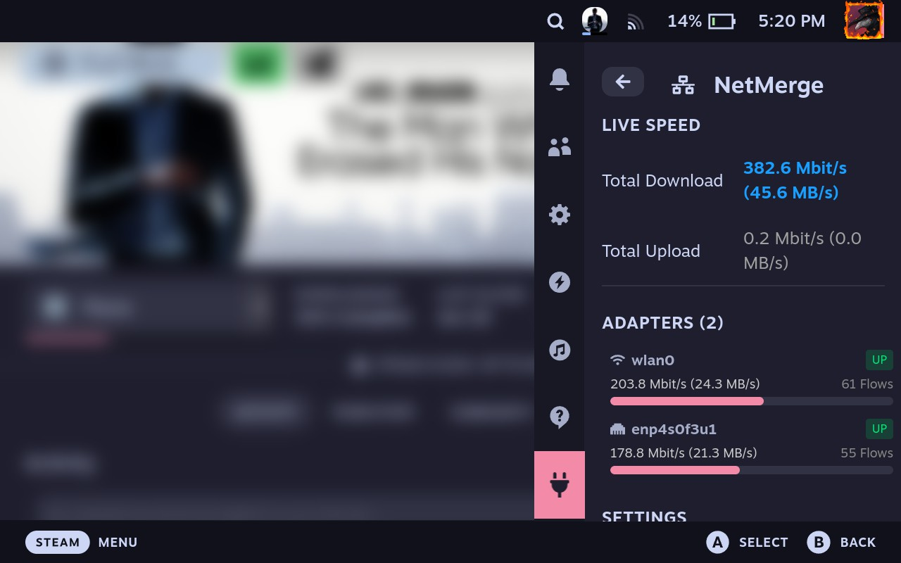

# NetMerge Decky Loader Plugin

Aggregate multiple network connections on Steam Deck (OLED and LCD) directly from the Quick Access Menu.

Every new connection (TCP and UDP, IPv4 and IPv6) is assigned to a physical link (internal Wi-Fi, USB-C Ethernet Dock, Phone USB Tethering), enabling multi-connection downloads such as Steam game downloads and updates to run over all available links simultaneously.

<p align="center">
  
</p>

## Credits

- Decky Loader Plugin and Steam Deck Port: [FlashWreck](https://github.com/flashwreck) ([FlashWreck/net-merge-decky](https://github.com/FlashWreck/net-merge-decky))
- Linux Port and Netlink Engine: [sidharthify](https://github.com/sidharthify) ([sidharthify/net-merge](https://github.com/sidharthify/net-merge))
- Original Windows Application: [rohit267](https://github.com/rohit267) ([rohit267/net-merge](https://github.com/rohit267/net-merge))

## Features for Steam Deck

- **Designed for Gaming Mode:** Controlled directly from the Steam Deck Quick Access Menu (`...` button).
- **Multi-Link Speed Boost:** Combines Wi-Fi, Ethernet Dock, and Phone USB Tethering for multi-connection Steam downloads.
- **Live Bandwidth Monitoring:** Real-time speedometer in the Quick Access Menu showing total download and upload speeds along with per-adapter throughput.
- **Dynamic Weighting:** Weights adapters automatically based on measured throughput and ignores links with captive portals or exhausted data.
- **Power Management Aware:** Monitors systemd logind sleep events (`PrepareForSleep`) over D-Bus. Cleanly disables routes before suspend and restores aggregation after wake.
- **No Rootfs Modifications:** Runs as a standalone Decky plugin inside `/home/deck/homebrew/plugins`. Does not disable `steamos-readonly` and does not require package installations.
- **Safe Failover:** Virtual TUN adapter routes are removed cleanly on pause, disable, or plugin unload.

## How It Works

1. **Traffic Capture:** When enabled, NetMerge creates a userland TUN adapter (`net-merge`) and configures netlink routes that intercept outbound flows.
2. **Userland Stack:** Packets entering the TUN are terminated in an efficient userland TCP/IP stack (gVisor / tun2socks).
3. **Egress Binding:** New flows are bound to physical interface source addresses and routed using `SO_BINDTOIFINDEX`, bypassing the TUN to avoid loops.
4. **Balancing:** Flows are distributed using weighted least-active scheduling according to real-time link throughput.

## Steam Deck Hardware & Kernel Optimizations

NetMerge is purpose-built for SteamOS and the Steam Deck's custom AMD Van Gogh APU:

- **AMD Zen 2 Microarchitecture Vectorization (`GOAMD64=v3`):** Compiled with native AVX2, FMA3, BMI1, and BMI2 vector instructions. Packet handling, memory copies, and userland TCP parsing leverage 256-bit SIMD registers to minimize APU memory bandwidth pressure.
- **BBR Congestion Control:** Outbound connections use Google's BBR congestion control algorithm (`TCP_CONGESTION="bbr"`). Unlike Cubic, BBR does not slash throughput on transient radio drops, maximizing speeds over Wi-Fi and mobile tethering.
- **Low-Latency TCP Socket Flags:** Outbound sockets enforce `TCP_NODELAY` to bypass Nagle's algorithm and `TCP_QUICKACK` to eliminate 40 ms delayed-ACK waits during concurrent Steam CDN chunk negotiations.
- **Dynamic Wi-Fi Power Save Jitter Prevention:** SteamOS enables aggressive 802.11 power saving by default, causing latency to periodically spike from 15 ms to 150+ ms. NetMerge automatically turns Wi-Fi power save off while aggregation is active and restores it when paused or stopped to preserve battery.

## Development and Build

Prerequisites on Build Machine:
- Go 1.23 or newer
- Node.js and pnpm (v9 or v11, generates lockfile v9)
- Make

### Build Plugin Locally

```bash
# Build backend Go static binary and frontend Rollup bundle
make all
```

The compiled plugin package will be created at `out/net-merge-decky.zip`.

### Direct Deployment to Steam Deck

```bash
# Deploy to Steam Deck over SSH and restart Decky Loader
make deploy DECK_IP=<your-deck-ip>
```

## Manual Installation on Steam Deck

1. Download `net-merge-decky.zip` from Releases.
2. Extract the folder to `/home/deck/homebrew/plugins/net-merge-decky`.
3. Restart the Decky Loader daemon:
   ```bash
   sudo systemctl restart plugin_loader
   ```
4. Open the Quick Access Menu (`...` button) in Gaming Mode and open the NetMerge tab.

## Feedback, Testing & Feature Requests

- **Bug Reports:** If an adapter fails to balance or you encounter routing issues, please [open an issue](https://github.com/FlashWreck/net-merge-decky/issues) with your Steam Deck model (LCD/OLED), SteamOS version, and adapter list.
- **Feature Requests:** Have ideas or features in mind? Please share your suggestions in [GitHub Issues](https://github.com/FlashWreck/net-merge-decky/issues).
- **Benchmark Reports:** Help us test! If you test multi-link speeds (e.g. Wi-Fi + 5G Tethering or Wi-Fi + Docked Ethernet), share your before/after download speeds and screenshots.

## License

NetMerge is released under the MIT License. See `LICENSE` and `THIRD-PARTY-NOTICES.md` for full terms.
